

<picture><source media="(prefers-color-scheme: dark)" srcset="assets/hero-dark.svg"></picture>

<picture><source media="(prefers-color-scheme: dark)" srcset="assets/social-l-dark.svg"></picture><a href="https://t.me/ZXCPZHRTU"><picture><source media="(prefers-color-scheme: dark)" srcset="assets/social-1-dark.svg"></picture></a><a href="https://discord.com/users/1089842229838876702"><picture><source media="(prefers-color-scheme: dark)" srcset="assets/social-2-dark.svg"></picture></a><picture><source media="(prefers-color-scheme: dark)" srcset="assets/social-r-dark.svg"></picture>

<picture><source media="(prefers-color-scheme: dark)" srcset="assets/about-dark.svg"></picture>

<picture><source media="(prefers-color-scheme: dark)" srcset="assets/stack-dark.svg"></picture>

<a href="https://github.com/ZXCPZHatert-RedFox-Dev/Red-Fox_RECOVERYRMX3624"><picture><source media="(prefers-color-scheme: dark)" srcset="assets/project-red-fox-recoveryrmx3624-dark.svg"></picture></a>&nbsp;<a href="https://github.com/ZXCPZHatert-RedFox-Dev/RedFox-Flasher"><picture><source media="(prefers-color-scheme: dark)" srcset="assets/project-redfox-flasher-dark.svg"></picture></a>

<a href="https://github.com/ZXCPZHatert-RedFox-Dev/RedFox-GKI-Kernel-Tecno-LI6"><picture><source media="(prefers-color-scheme: dark)" srcset="assets/project-redfox-gki-kernel-tecno-li6-dark.svg"></picture></a>&nbsp;<a href="https://github.com/ZXCPZHatert-RedFox-Dev/RMX3624-GKI-5.4-Kernel"><picture><source media="(prefers-color-scheme: dark)" srcset="assets/project-rmx3624-gki-5-4-kernel-dark.svg"></picture></a>

<a href="https://github.com/ZXCPZHatert-RedFox-Dev/RedFox-Manager"><picture><source media="(prefers-color-scheme: dark)" srcset="assets/project-redfox-manager-dark.svg"></picture></a>&nbsp;<a href="https://github.com/ZXCPZHatert-RedFox-Dev/RedFoxGram"><picture><source media="(prefers-color-scheme: dark)" srcset="assets/project-redfoxgram-dark.svg"></picture></a>

<a href="https://github.com/ZXCPZHatert-RedFox-Dev/Quickshell-Vault"><picture><source media="(prefers-color-scheme: dark)" srcset="assets/project-quickshell-vault-dark.svg"></picture></a>&nbsp;<a href="https://github.com/ZXCPZHatert-RedFox-Dev/ZXCPZHatert-RedFox-Dev"><picture><source media="(prefers-color-scheme: dark)" srcset="assets/project-zxcpzhatert-redfox-dev-dark.svg"></picture></a>

<picture><source media="(prefers-color-scheme: dark)" srcset="assets/stats-dark.svg"></picture>

<picture><source media="(prefers-color-scheme: dark)" srcset="assets/streak-dark.svg"></picture>

<picture><source media="(prefers-color-scheme: dark)" srcset="assets/wave-dark.svg"></picture>

<a href="https://t.me/ZXCPZHRTU"><picture><source media="(prefers-color-scheme: dark)" srcset="assets/button-1-dark.svg"></picture></a>&nbsp;&nbsp;<a href="https://github.com/ZXCPZHatert-RedFox-Dev?tab=repositories"><picture><source media="(prefers-color-scheme: dark)" srcset="assets/button-2-dark.svg"></picture></a>

<a href="https://metawka.github.io/expressive-profile/?from=ZXCPZHatert-RedFox-Dev"><picture><source media="(prefers-color-scheme: dark)" srcset="assets/credit-dark.svg"></picture></a>

